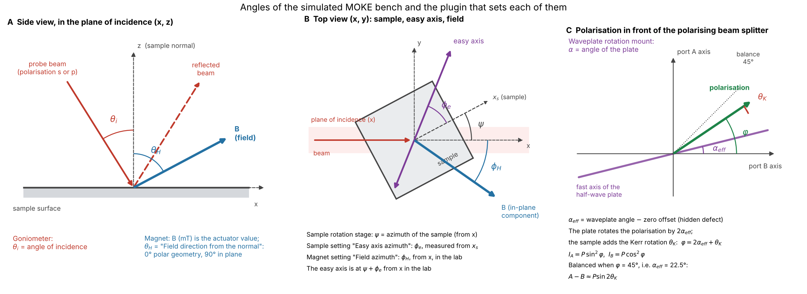

pymodaq_plugins_moke
####################

.. image:: https://img.shields.io/pypi/v/pymodaq_plugins_moke.svg
   :target: https://pypi.org/project/pymodaq_plugins_moke/
   :alt: Latest Version

.. image:: https://github.com/PyMoDAQ/pymodaq_plugins_moke/actions/workflows/tests.yml/badge.svg
   :target: https://github.com/PyMoDAQ/pymodaq_plugins_moke/actions/workflows/tests.yml

PyMoDAQ plugins for magneto-optical Kerr effect (MOKE) measurements at CEMES: the macro bench (a photodetector
and an electromagnet) and the micro bench (Kerr microscope with a camera and LED illumination).

This branch targets **PyMoDAQ 5.3.x** (Python 3.11 to 3.14).

Authors
=======

* Sebastien Weber (sebastien.weber@cemes.fr)

Instruments
===========

Below is the list of instruments included in this plugin

Actuators
+++++++++

* **Current**: current of the electromagnet, through a National Instruments analog output (needs ``pymodaq_plugins_daqmx``)
* **CurrentMock**: simulated version of the above, with a magnetic hysteresis
* **LedDC4104**: Thorlabs DC4104 four-channel LED driver of the Kerr microscope
* **MokeMagnetSim**: simulated electromagnet (field in mT, first order response), see *Simulated MOKE bench* below
* **MokeWavePlateSim**: simulated half-wave plate rotation mount (balance of the detection)
* **MokeSampleRotationSim**: simulated rotation of the sample about its normal
* **MokeGoniometerSim**: simulated angle of incidence

Viewer0D
++++++++

* **ReadCurrent**: reads the electromagnet current on a National Instruments analog input
* **MokeBalancedSim**: simulated balanced detection (two photodiodes), see *Simulated MOKE bench* below

Viewer1D
++++++++

* **MokeMacro**: detection of the macro MOKE bench

Viewer2D
++++++++

* **MOKEGrabber**: Andor sCMOS camera of the Kerr microscope (needs ``pymodaq_plugins_andor``)
* **MOKEMockGrabber**: simulated Kerr microscope image, with a magnetic hysteresis

Extensions
==========

* **MicroMOKE**: acquisition of Kerr microscope images with the sequence of LED illuminations

Simulated MOKE bench
====================

``MokeMagnetSim``, ``MokeWavePlateSim``, ``MokeSampleRotationSim``, ``MokeGoniometerSim`` and ``MokeBalancedSim`` simulate
a MOKE bench with balanced detection, to develop and test acquisitions, scans and extensions without hardware.
The five plugins share one simulated bench through the controller: give them the same *controller ID* in the Dashboard,
one as ``Master`` (it creates the bench) and the others as ``Slave``. A plugin alone works as a master on its own bench.

* The magnet field (mT) drives the magnetisation of a simulated sample. Two models: Stoner-Wohlfarth (vector
  magnetisation, uniaxial anisotropy ``Hk`` along an easy axis, switching when the energy minimum disappears) and a
  scalar ``tanh`` loop (coercive field, width).
* The Kerr rotation is the sum of a polar term (magnetisation along the normal) and a longitudinal one (in the plane of
  incidence, proportional to the sine of the angle of incidence). The geometry follows from the direction of the
  field, the easy axis, the sample rotation and the angle of incidence. A transverse term changes the intensity (``p``
  polarisation only).
* The detector emits one 0D dataset with four channels in V: ``diode_A``, ``diode_B``, ``difference`` and ``sum``.
  The balance is set by the half-wave plate angle (22.5 deg from its zero, an offset of which can be hidden), the
  Kerr rotation is ``difference / (2 * sum)`` near the balance. The plugins add no Kerr rotation and no semantic
  annotation: that is left to the extension or the analysis.
* Optional imperfections, each adjustable: shot noise, electronic noise, laser intensity noise (common mode),
  gain imbalance between the diodes, Faraday rotation of the optics, slow drift.

The angles that the plugins control, and how they are measured, are drawn below (``docs/make_angles_figure.py``
regenerates the figure): the angle of incidence (goniometer), the direction of the field (settings of the magnet),
the azimuth of the sample (rotation stage) and of its easy axis, and the angle of the half-wave plate that balances the
detection.

The equations, the settings and the limits of the model are described in ``docs/source/simulated_bench_model.md`` (published as a GitHub Pages site by the ``documentation`` workflow).

The physics is approximate (see ``hardware/simulated_bench.py``) and has not been reviewed by MOKE experts yet.

Installation instructions
=========================

* PyMoDAQ 5.3.7 or later.
* The National Instruments and Andor drivers are needed by the plugins that use them (see ``pymodaq_plugins_daqmx``
  and ``pymodaq_plugins_andor``).

Development
===========

* Install your plugin in editable mode: ``pip install -e .``
* Check it, without any hardware: ``check_plugin`` (and ``pytest``)
* If you use an AI coding assistant, point it to ``AGENTS.md``: it describes the patterns to follow for instrument
  plugins, Dashboard extensions (``CustomExt``, whenever instruments are involved) and standalone apps
  (``CustomApp``, only if no instruments are needed).
