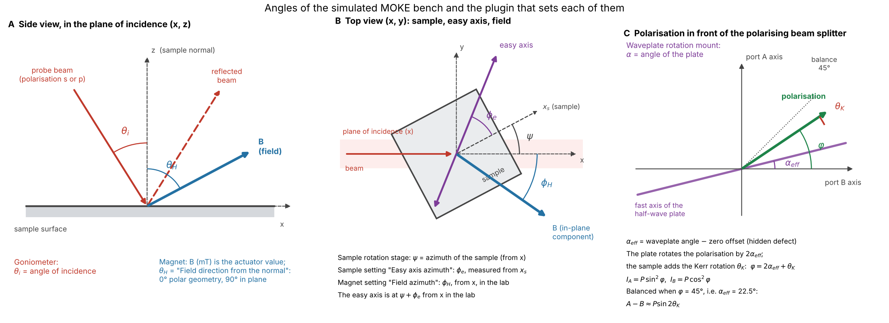

# Model of the simulated MOKE bench

This page describes what the five `Moke...Sim` plugins compute (`src/pymodaq_plugins_moke/hardware/simulated_bench.py`),
so that a user can choose the settings, check a result by hand, and know what is not simulated. The physics is a
**deliberately simple model**, written from general knowledge of the magneto-optical Kerr effect. It has **not been
reviewed by MOKE experts** yet, and nothing in it was compared with a real bench.

The angles are drawn below.



## 1. Overview

```
 magnet B(t) ──► magnetisation m ──► Kerr rotation θ_K ──► polarisation ──► half-wave plate ──► beam splitter ──► diodes A, B
 (MokeMagnetSim)   (sample model)     (geometry: θ_i, ψ)   φ = 2α_eff + θ_K  (MokeWavePlateSim)                    (MokeBalancedSim)
```

All the plugins share one object, the *bench* (`MokeBench`), through the PyMoDAQ controller: give them the same
controller ID, one as `Master` (it creates the bench), the others as `Slave`. A plugin alone is its own master.

Lab frame: `z` is the normal of the sample, `x` lies in the plane of incidence, `y` is perpendicular to both.

| Plugin | Quantity | Unit | Default | Where it enters |
|---|---|---|---|---|
| `MokeMagnetSim` | field `B` | mT | 0 | magnet (section 2) |
| `MokeMagnetSim` setting | response time `tau` | ms | 50 | magnet |
| `MokeMagnetSim` settings | field direction `θ_H` (from the normal) and `φ_H` (azimuth) | deg | 0, 0 | magnet, magnetisation |
| `MokeSampleRotationSim` | sample azimuth `ψ` | deg | 0 | easy axis in the lab frame |
| `MokeGoniometerSim` | angle of incidence `θ_i` | deg | 45 | Kerr rotation |
| `MokeWavePlateSim` | plate angle `α` | deg | 22.5 | balance |
| `MokeBalancedSim` settings | sample, optics, imperfections | see sections 3 to 6 | | |

Settings of the detector are sent to the bench when they change (`commit_settings`) and at initialisation. Several
detectors or actuators do not conflict: each plugin only sets its own settings.

## 2. Magnet

The applied field `B` (mT) follows its target `B_t` with a first-order response:

$$B(t + \Delta t) = B_t + \left(B(t) - B_t\right) e^{-\Delta t/\tau}$$

The bench computes this lazily, each time somebody asks for the field or for a signal, from the time elapsed since
the previous call. `tau = 0` is an instantaneous magnet. The actuator is polled by PyMoDAQ until the field is within
`epsilon` (0.5 mT by default) of the target, as for a real power supply.

The field is a vector of norm `B` along the direction given by the polar angle `θ_H` (0°: along the normal, polar
geometry; 90°: in the plane) and the azimuth `φ_H` (0°: in the plane of incidence).

**B and H.** The simulation uses the applied field `B = μ0 H` in vacuum or air: 1 mT corresponds to 795.8 A/m, or
10 Oe. The actuator axis is in mT; `pint` converts mT to A/m but not directly to Oe (CGS). Which of `B` or `H` is the
right quantity to record is still to be decided with the experts.

## 3. Magnetisation of the sample

The state of the sample is a unit vector `m = (m_x, m_y, m_z)` in the lab frame. Two models, chosen in the detector
setting *Magnetisation model*.

The easy axis `e` is fixed in the sample: its polar angle `θ_e` (*Easy axis from the normal*) and its azimuth `φ_e`
(*Easy axis azimuth*) are given in the sample frame. The sample rotation `ψ` turns it about `z`, so in the lab frame
its azimuth is `φ_e + ψ`.

### 3.1 Stoner-Wohlfarth (default)

A single magnetic domain with a uniaxial anisotropy along `e` and a Zeeman term. With `h = B / H_k` the reduced field
vector (`H_k`, in mT, is the setting *Anisotropy field*), the energy density divided by `2K` is:

$$ e(\mathbf m) = -\tfrac12 (\mathbf m\cdot\mathbf e)^2 - \mathbf h\cdot\mathbf m $$

`m` always sits in a **local minimum** of `e` on the unit sphere, the one it was already in. When the field changes,
the simulation moves the minimum with the field and lets `m` relax to it (gradient descent, step 0.4, at most 600
iterations, the field change being cut into steps of at most 2% of `H_k`). The minimum disappears at the switching
field and `m` jumps to the other one. **This is what produces the hysteresis**: the state depends on the history of
the field, not only on its present value. A tiny random tilt of `m` (1e-4 rad, a stand-in for thermal fluctuations)
is added before each relaxation: without it `m` would stay forever on an unstable point when the field is exactly
along the easy axis.

Checks that the model reproduces (they are in the tests):

| Angle ψ_H between the field and the easy axis | Switching field | Loop |
|---|---|---|
| 0° | `H_k` | square |
| 45° | `H_k / 2` | open, rounded |
| 90° | none (saturation at `H_k`) | closed, no hysteresis |

The general switching field is `H_k / (cos^{2/3}ψ_H + sin^{2/3}ψ_H)^{3/2}` (the Stoner-Wohlfarth astroid).

This is a **coherent rotation** model: no domains, no domain-wall propagation, no thermal activation, no minor-loop
memory beyond what the single minimum gives. Real thin films with a square loop switch by nucleation and wall motion at
a field below `H_k`: use the *tanh* model to put a measured coercive field.

### 3.2 tanh loop

A scalar loop along the easy axis, for a quick and readable hysteresis. The field component along the easy axis is
`h = B (\mathbf{B}_{dir} \cdot \mathbf e)`. Two branches limit the amplitude `a = \mathbf m \cdot \mathbf e`:

$$ a_\uparrow(h) = \tanh\frac{h - H_c}{w}, \qquad a_\downarrow(h) = \tanh\frac{h + H_c}{w} $$

with the coercive field `H_c` and the switching width `w` (settings, in mT). When the field increases `a` becomes
`max(a, a_↑(h))`, when it decreases `a` becomes `min(a, a_↓(h))`. `m = a e`. The loop is symmetric, saturates at
`|a| = 1`, and has no angle dependence other than the projection of the field on the easy axis.

## 4. Kerr rotation

For the magnetisation `m` and the angle of incidence `θ_i`, the polarisation rotation (rad) is:

$$ \theta_K = K_\mathrm{pol}\, m_z + K_\mathrm{long} \sin\theta_i\; m_x $$

`K_pol` (*Polar Kerr rotation*, default 0.5 mrad) is the rotation at saturation with `m` along `+z`. `K_long`
(*Longitudinal Kerr rotation*, default 0.3 mrad) is the rotation at saturation and 90° incidence with `m` along `+x`,
in the plane of incidence. So:

* the polar term is independent of the angle of incidence (a simplification),
* the longitudinal term grows as `sin θ_i` and vanishes at normal incidence,
* the component `m_y`, perpendicular to the plane of incidence (transverse geometry), gives no rotation.

For **s polarisation** the rotation is multiplied by *Kerr s / p ratio* (default 1). This is a placeholder: a real
sample has different Kerr rotations in s and p, to be measured.

The **transverse** term changes the reflected intensity, in p polarisation only:

$$ P \;\to\; P\,\left(1 + K_\mathrm{trans}\, \sin\theta_i\; m_y\right) $$

with *Transverse reflectivity change* `K_trans` (default 1e-3), visible on the `sum` channel.

Not simulated: Kerr ellipticity, wavelength dependence, quadratic MOKE (terms in `cos 2φ`), temperature, dependence
of `K` on the angle of incidence beyond `sin θ_i`.

## 5. Balanced detection

After the sample the beam crosses a half-wave plate and a polarising beam splitter (Wollaston) that sends the
components along its two axes to photodiodes A and B.

A half-wave plate whose fast axis makes an angle `α_eff` with the axis of port B rotates the polarisation by
`2 α_eff`. The beam starts polarised along the axis of port B, so the angle `φ` of the polarisation to that axis is:

$$ \varphi = 2\,\alpha_\mathrm{eff} + \theta_K, \qquad \alpha_\mathrm{eff} = \alpha - \alpha_0 $$

where `α` is the angle of the plate (`MokeWavePlateSim`) and `α_0` the **zero offset** of the plate (detector setting
*Waveplate zero offset*, default 0°; the user does not know it and finds the balance by looking for a zero
difference). With `P` the power on the diodes (section 5.1), Malus' law gives:

$$ P_A = P \sin^2\varphi, \qquad P_B = P \cos^2\varphi, \qquad P_A - P_B = -P\cos 2\varphi $$

At the **balance**, `α_eff = 22.5°` (`φ = 45°`), `P_A = P_B` when `θ_K = 0` and

$$ P_A - P_B = P \sin 2\theta_K \approx 2 P \theta_K $$

Away from the balance by `δ` (in polarisation angle, `δ = 2 α_eff - 45°`):

$$ P_A - P_B = P \sin\!\big(2(\theta_K + \delta)\big) $$

* **offset** at zero field: `P sin 2δ`;
* **sensitivity** to `θ_K`: multiplied by `cos 2δ` (maximal at the balance; 10° of plate is `δ = 20°`, a factor 0.77);
* the laser intensity noise cancels in the difference only at `δ = 0` (section 6).

### 5.1 From power to volts

$$ P = P_0\, R\,\big(1 + \text{transverse term}\big) $$

with `P_0` the *Power on the sample* (1 mW) and `R` the *Sample reflectivity* (0.5). Each diode converts power to
voltage with the *responsivity* `ρ` (0.5 A/W) and the *amplifier gain* `G` (1 kV/A by default, setting in kV/A):

$$ V_A = G \rho P_A, \qquad V_B = G \rho P_B $$

The detector emits one 0D dataset, in V, with four channels:

| Channel | Content |
|---|---|
| `diode_A` | `V_A` |
| `diode_B` | `V_B` |
| `difference` | `V_A - V_B` |
| `sum` | `V_A + V_B` |

**Recovering the Kerr rotation.** The plugins do not compute it, so that any digitiser can be used with the same
analysis. With equal gains, near the balance: `θ_K ≈ difference / (2 sum)` (rad). In general:
`θ_K = ½ arccos(−difference / sum) − 2 α_eff`. With the default values, `θ_K = 0.5 mrad` gives a difference of
250 µV on a sum of 250 mV.

## 6. Imperfections

The group *Imperfections* has a master switch (*Enabled*) and one switch per defect, each with its own value. Nothing
is added when the master switch is off, and `grab_data` is then deterministic.

| Defect (setting) | Default | Model |
|---|---|---|
| Shot noise | on | white noise on each diode current, `σ_i = sqrt(2 q I B_w)`, with `I = ρ P_{A,B}` and the bandwidth `B_w = 1/(2 t_int)` from the *Integration time* (10 ms by default) |
| Electronic noise | on, 20 µV rms | independent Gaussian noise on each channel voltage |
| Laser intensity noise | on, 0.1 % rms | the power `P` is multiplied by `1 + ε`, `ε` Gaussian: **common** to both diodes, so it appears in `sum` and cancels in `difference` only when `P_A = P_B` (balanced, no gain imbalance) |
| Gain imbalance A/B | off, 2 % | the gain of A is multiplied by `1 + g/2` and that of B by `1 - g/2`, `g` being the difference: the difference signal does not vanish at the balance and the laser noise leaks into it |
| Faraday rotation of the optics | off, 5 µrad/mT | `θ_K` receives a linear term `k_F B` (field-dependent background that has to be subtracted from the loops) |
| Slow drift of the polarisation | off, 0.2 mrad, 60 s | `θ_K` receives `A sin(2π t / T)` |

`Naverage` in `grab_data` averages that number of independent readings.

## 7. What the model does not do

* No domain structure, no minor loops with return-point memory, no thermal or viscous effects, no dependence on the
  sweep rate other than through the magnet response time.
* No Kerr ellipticity, quarter-wave compensator, PEM or lock-in (a modulated detection is planned as a separate
  detector).
* No dependence on the wavelength or the temperature, which exist in the MOKE ontology (`moke:Wavelength`,
  `moke:SampleTemperature`).
* No drift or hysteresis of the magnet itself (remanent field, heating), no Hall probe: the field read back is the
  modelled field.
* The simulation gives **no semantic annotation**; adding the role, quantity kind and unit of the data is the job of the
  extension that uses the plugins.

## 8. Using it

1. Add the five plugins to a Dashboard experiment with the same *controller ID*, the magnet as `Master`.
2. Set the sample (anisotropy field, easy axis, Kerr rotations) and, if wanted, the imperfections in the detector.
3. Look for the balance: scan the plate angle and find `difference = 0` (22.5° plus the hidden offset).
4. Scan the field with the magnet as the scan axis and the detector as the signal: a hysteresis loop of the
   `difference` channel. Change `θ_i`, `ψ`, the field direction or the plate to see how the loop changes.

The tests in `tests/test_simulated_bench.py` check the loop, the balance, the sensitivity, the geometry and the
imperfections; `tests/test_simulated_plugins.py` drives the plugins as the Dashboard does (not through its GUI).
